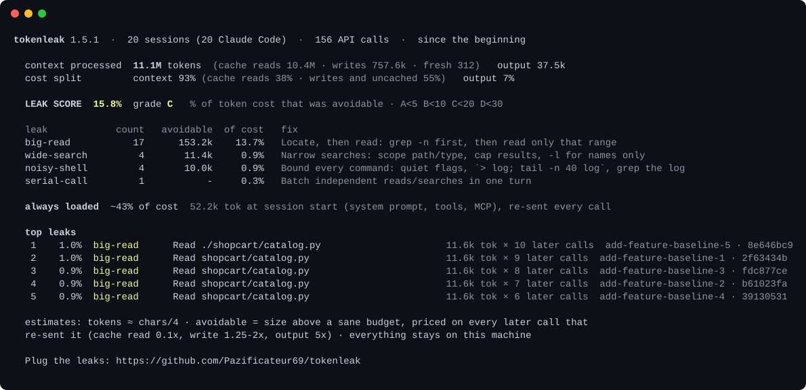

<p align="center"></p>

<h1 align="center">tokenleak</h1>

<p align="center"><b>Find and plug your coding agent's token leaks.</b><br>
Not leaked API keys: the tokens your AI agent burns on context it didn't need.</p>

<p align="center">
<a href="https://pazificateur69.github.io/tokenleak/">Website</a> · <a href="#install">Install</a> · <a href="#the-audit">Audit</a> · <a href="#benchmark">Benchmark</a> · <a href="#the-rules">Rules</a> · <a href="README.fr.md">Français</a>
</p>

<p align="center"></p>

**−40% cost on a 40-run A/B benchmark, same pass rate (20/20).** [Details](#benchmark).

## Why

In an agent loop, **every tool result you let into context is re-sent on every later call** until the context is compacted. A 6k-token test log read at call 5 of a 60-call session gets paid ~55 more times. Every extra round-trip re-sends the whole context.

So the bill isn't driven by how chatty the agent is. It's driven by **what it lets into its context, and how early**. Making replies shorter saves the cheap part; on real coding sessions most of the cost is context re-reads.

tokenleak does two things:

1. **Rules** (a skill, ~850 tokens) that make any coding agent let in only what the next decision needs: locate then read, compute instead of reading data, bound every command's output, never re-read, batch independent calls, diffs over files, edit don't rewrite. With guardrails, so it never saves tokens by guessing or skipping verification.
2. **An audit** that reads *your own* Claude Code and Codex transcripts and shows where the tokens actually went: every oversized read, noisy log, wasted call and serial round-trip, priced by the **context tax** it imposed, with the rule that fixes it. Local, read-only, zero dependencies.

## Install

**Claude Code (plugin, recommended).** Rules injected at session start, after compaction, and into every subagent. Adds the `/tokenleak` skill.

```
/plugin marketplace add Pazificateur69/tokenleak
/plugin install tokenleak@tokenleak
```

**Any agent that supports Agent Skills** (Codex, Cursor, Gemini CLI, GitHub Copilot, Windsurf, Cline, OpenCode and [50+ more](https://github.com/vercel-labs/skills#supported-agents)):

```bash
npx skills add Pazificateur69/tokenleak -g
```

**Always on, any agent, no install.** Append the rules to your instructions file (`AGENTS.md`, `CLAUDE.md`, `GEMINI.md`, `.cursorrules`…):

```bash
curl -fsSL https://raw.githubusercontent.com/Pazificateur69/tokenleak/main/skills/tokenleak/SKILL.md | awk 'f>=2;/^---$/{f++}' >> AGENTS.md
```

## The audit

```bash
# no install: Python 3.8+, stdlib only, reads ~/.claude/projects and ~/.codex/sessions
curl -fsSL https://raw.githubusercontent.com/Pazificateur69/tokenleak/main/skills/tokenleak/scripts/tokenleak.py | python3 - --since 30d
```

Or from a clone: `python3 skills/tokenleak/scripts/tokenleak.py`. Or just ask your agent: *"audit my token leaks"*.

| flag | |
|---|---|
| `--since 24h \| 7d \| 4w \| 2026-10-01 \| all` | time window (default `7d`) |
| `--here` / `--current` | sessions in this directory / only the latest one |
| `--project TEXT`, `--session ID`, `--agent claude\|codex` | filters |
| `--top N` | individual leaks to list (default 10) |
| `--json` | machine-readable, for CI or dashboards |
| `--share` | small anonymized card for posting |
| `--redact` | hide commands, paths and project names |

### What it finds

| leak | what happened | rule that fixes it |
|---|---|---|
| `big-read` | a file read far bigger than the part you needed | Locate, then read |
| `noisy-shell` | tests, builds, installs or logs dumped into context | Bound every command |
| `re-read` | a file read again, unchanged, while still in context | Never re-read |
| `wasted-call` | the same call, same answer, again (incl. Claude Code's "file unchanged" round-trips) | Never re-read |
| `serial-call` | two independent reads/searches done one turn after the other | Batch independent calls |
| `wide-search` | a search that returned pages of matches | Narrow searches |
| `big-fetch` | a web page or MCP/API payload dumped whole | Narrow fetches |
| `rewrite` | a whole file rewritten to change a few lines | Edit, don't rewrite |
| `verbose-reply` | long recap prose | Answer lean |

It also shows what's **always loaded**: your `CLAUDE.md` / `AGENTS.md` / memory files and the base context (system prompt, tools, MCP servers) re-sent on every call, with their share of your cost. Not counted as leaks, but often the cheapest win.

### How it's computed

For each tool result: **context tax = avoidable tokens × (cache write + every later call in the same context × cache read)**, using each provider's relative prices (Claude: cache read 0.1×, cache write 1.25–2×, output 5×; Codex/GPT-5: cached 0.1×, output 8×). *Avoidable* is conservative: only the part above a sane budget (e.g. a 6k-token read counts as 4k avoidable), the full size only for exact repeats. The **leak score** is the share of your total token cost that was avoidable. Dollar amounts come from Claude Code's own per-session cost, never from a price table we maintain.

Everything stays on your machine: no network, no telemetry, ~900 lines of stdlib Python you can read in ten minutes.

## Benchmark

A/B test in Claude Code (`claude -p`, Sonnet 5): same prompt, a fresh copy of the same small repo for every run, 5 runs per arm. The **only** difference is the tokenleak rules appended to the system prompt (what the plugin injects). Every run is checked by a script: tests green, build passing, exact answer, feature working.

| task | without | with tokenleak | change | passed |
|---|---|---|---|---|
| fix a failing test (chatty test logs) | $0.140 | $0.140 | 0% | 5/5 · 5/5 |
| answer a question about data in a big module | $0.206 | $0.160 | **−22%** | 5/5 · 5/5 |
| fix a build buried in 600 lines of output | $0.267 | $0.159 | **−40%** | 5/5 · 5/5 |
| add a feature *(held out, see below)* | $0.459 | $0.184 | **−60%** | 5/5 · 5/5 |
| **total** | **$1.07** | **$0.64** | **−40%** | **20/20 · 20/20** |

Median API-equivalent cost per run, as reported by Claude Code. On every task where it helped, the most expensive tokenleak run cost less than the cheapest run without it. Context tokens −28%, output tokens −17%. The image at the top is the audit of the 20 runs *without* the rules.

**Read it honestly.**
- The rules were piloted first (v1, 30 runs: −23%, 15/15 vs 15/15). Reading those transcripts led to two new rules (check a file's size before opening it; compute, don't read data). So that this isn't tuning on the test, a fourth task, `add-feature`, was written before the change and never used to tune the rules: it shows the biggest gain. Both runs, with the exact rules used, are in [bench/results](bench/results).
- One model, four small tasks, a synthetic repo built to contain what leaks in real ones (a big data module, chatty logs, a noisy build). Your numbers will differ: run the audit on your own sessions before and after.
- Runs are isolated from your settings, CLAUDE.md, plugins and MCP servers (`--setting-sources project --strict-mcp-config`) and sandboxed away from your personal folders.

Reproduce: `python3 bench/run.py --runs 5` (40 runs, about $9 of API-equivalent usage).

## The rules

The full skill is [skills/tokenleak/SKILL.md](skills/tokenleak/SKILL.md). In short:

1. **Locate, then read.** Check the size, `grep -n`, then read only that range.
2. **Compute, don't read.** Questions about data get a one-liner that prints the answer, not the data.
3. **Bound every command.** Quiet flags; long jobs go to a log file, read with `tail`, dig with `grep`. Never re-run just to see more.
4. **Never re-read** what is already in context.
5. **Batch independent calls** in one turn, and chain shell steps in one command.
6. **Diffs over files.** `git diff --stat` before `git diff`.
7. **Edit, don't rewrite.**
8. **Narrow searches and fetches.** Scope, cap, select fields.
9. **Delegate wide exploration** to a subagent; only its summary comes back.
10. **Answer lean.** Result first, no recap.

And never save tokens by truncating away the real error, guessing file contents, or skipping verification.

## FAQ

**Does it make the agent worse?** It shouldn't, and the benchmark checks every run for correctness. The guardrails are explicit: a leak is cheaper than a wrong fix.

**My agent already does some of this.** Good agents do. Claude Code, for one, already blocks re-reading an unchanged file; the audit counts those blocked attempts as wasted round-trips. The audit tells you how much is left on your own sessions, not on a demo.

**What about rtk, caveman and the rest?** Complementary. rtk compresses command output at the shell level; output-style skills shorten replies. tokenleak changes *what the agent asks for* and measures the result on your real transcripts. Run the audit before and after anything you install.

**What do the rules cost?** About 850 tokens, cached after the first call. One avoided full-file read pays for a whole session.

**Limitations.** Token sizes of individual results are estimated (~4 chars/token); session totals and costs are exact. "Avoidable" is a judgment, kept conservative. `serial-call` is a heuristic (it only flags a call whose target was already known and isn't mentioned in the previous result). Codex transcript formats change between versions; Claude Code is the best-tested path.

## Contributing

Issues and PRs welcome, especially transcripts formats from other agents (Gemini CLI, Cursor, OpenCode) and new leak detectors. Tests: `python3 -m unittest discover -s tests`. Benchmark: `python3 bench/run.py --runs 5`.

MIT License.
